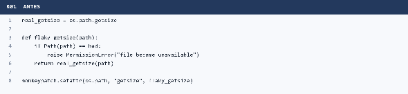
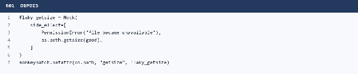
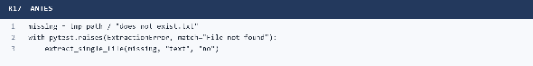
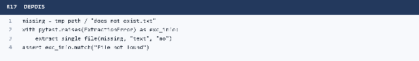
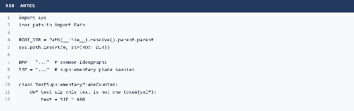
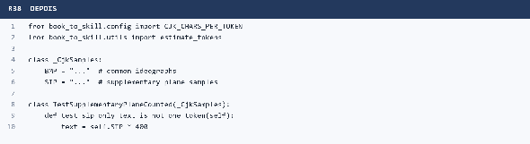
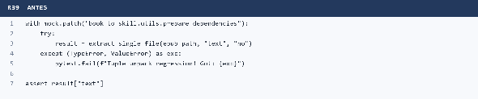
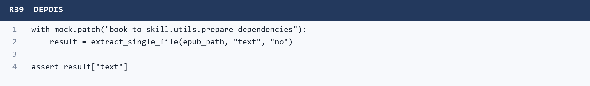

**UNIVERSIDADE FEDERAL DO CEARÁ** 
**CAMPUS QUIXADÁ** 
**CURSO DE GRADUAÇÃO EM ENGENHARIA DE SOFTWARE**

**Relatório Final** 
**Qualidade de Software**

**QUIXADÁ** 
**2026**

# Sumário

- [1. Informações do Projeto](#1-informações-do-projeto)
- [2. Apresentação do projeto](#2-apresentação-do-projeto)
- [3. Estado inicial do projeto](#3-estado-inicial-do-projeto)
  - [3.1. Test smells detectados antes da refatoração (TEMPY)](#31-test-smells-detectados-antes-da-refatoração-tempy)
  - [3.2. Resultados dos testes e cobertura antes da refatoração (Pytest)](#32-resultados-dos-testes-e-cobertura-antes-da-refatoração-pytest)
  - [3.3. Métricas do código de teste antes da refatoração (Radon)](#33-métricas-do-código-de-teste-antes-da-refatoração-radon)
- [4. Refatorações realizadas](#4-refatorações-realizadas)
  - [4.1. Seleção das ocorrências](#41-seleção-das-ocorrências)
  - [4.2. Lista das refatorações](#42-lista-das-refatorações)
  - [4.3. Exemplos detalhados](#43-exemplos-detalhados)
- [5. Estado final e comparação](#5-estado-final-e-comparação)
- [6. Análise dos resultados](#6-análise-dos-resultados)
- [7. Uso do CATSPY](#7-uso-do-catspy)
- [8. Divisão do trabalho](#8-divisão-do-trabalho)
- [9. Dificuldades e lições aprendidas](#9-dificuldades-e-lições-aprendidas)
- [10. Contribuição (Pull Request)](#10-contribuição-pull-request)
- [11. Observações gerais](#11-observações-gerais)

## 1. Informações do Projeto

**Projeto:** [book-to-skill](https://github.com/virgiliojr94/book-to-skill) 
**Fork:** [kaylannesatiro/book-to-skill](https://github.com/kaylannesatiro/book-to-skill) 
**Pull Request:** [#321 - refactor(tests): reduce detected test smells](https://github.com/virgiliojr94/book-to-skill/pull/321) 
**Commit SHA final do PR:** 5aacc33d8eef23dda806ea7cb8d24c51838b9963 
**Commit-base das medições:** e180fc46365e8c1aab0120778cc8a40b9515324b; 
**Commit final das medições:** 10107083b15b529b8642cbb030fa8b8dfe7d18e7 
**Equipe:**

- Carla Cristina Sousa Araújo - 571600
- Kaylanne de Jesus Sousa Sátiro - 567741

## 2. Apresentação do projeto

O book-to-skill transforma livros, documentos e conjuntos de fontes em Agent Skills estruturadas, que podem ser consultadas sob demanda por agentes como GitHub Copilot CLI, Amp, Claude Code, Codex, Hermes Agent, OpenCode e OpenClaw. O projeto possui duas partes principais: um extrator determinístico em Python, responsável por converter PDF, EPUB, DOCX, HTML, RTF e texto em conteúdo limpo e metadados; e um gerador orientado pela especificação SKILL.md, que organiza esse conteúdo em uma skill com índice, capítulos, glossário, padrões e material de consulta rápida.

Os testes são implementados com Pytest e ficam principalmente em tests/, com testes adicionais de avaliação em tests/evals/. A suíte é dividida por comportamento ou componente, incluindo extração de formatos, detecção de capítulos, sanitização Unicode, segurança, integração com diferentes hosts, higiene do repositório e ferramentas de avaliação. Há testes em funções e em classes, além de parametrizações, fixtures, mocks, monkeypatch e arquivos temporários.

## 3. Estado inicial do projeto

### 3.1. Test smells detectados antes da refatoração (TEMPY)

As medições foram realizadas sobre o commit-base fixo e180fc46365e8c1aab0120778cc8a40b9515324b. O TEMPY analisou 30 arquivos de teste.

| Test smell | Ocorrências detectadas |
| :---- | :---- |
| Conditional Test Logic | 47 |
| Unknown Test | 13 |
| Programming Paradigms Blend | 9 |
| Exception Handling | 7 |
| Undefined Test | 2 |
| Verbose Test | 1 |
| **Total** | **79** |

### 3.2. Resultados dos testes e cobertura antes da refatoração (Pytest)

| Métrica | Valor |
| :---- | :---- |
| Testes coletados | 813 |
| Testes aprovados (Passed) | 756 |
| Testes com falha (Failed) | 22 |
| Erros (Errors) | 0 |
| Ignorados (Skipped) | 35 |
| Cobertura total | 81,1962% |

As 22 falhas foram reproduzidas na base e não foram causadas pelas refatorações: 17 dependiam de um ambiente Bash utilizável e cinco estavam relacionadas a diferenças preexistentes de normalização CRLF/LF no Windows.

### 3.3. Métricas do código de teste antes da refatoração (Radon)

| Métrica | Valor |
| :---- | :---- |
| SLOC total dos testes | 5.879 |
| Complexidade ciclomática média das funções de teste | 2,6935 |
| Índice de manutenibilidade médio dos arquivos de teste | 57,2469 |

As métricas foram reproduzidas com o Radon 6.0.1 sobre os 49 arquivos Python de tests/ em cada estado. O SLOC foi retirado da linha TOTAL, com origem = teste, do arquivo metrics-before-radon/radon-raw.csv. A complexidade média considera funções, métodos e closures e exclui os blocos-resumo de classes, reproduzindo os valores históricos do trabalho. O índice de manutenibilidade corresponde à média dos 49 arquivos.

## 4. Refatorações realizadas

### 4.1. Seleção das ocorrências

Foram selecionadas 40 ocorrências distintas, divididas igualmente entre as duas integrantes. A seleção contemplou quatro categorias do CATSPY: Conditional Test Logic, Unknown Test, Programming Paradigms Blend e Exception Handling.

Conditional Test Logic recebeu a maior prioridade porque era a categoria mais frequente, com 47 ocorrências, e porque decisões e iterações dentro dos testes podiam ocultar quais entradas e resultados eram realmente esperados.

Unknown Test foi selecionado para tornar verificações de exceções mais explícitas.

Programming Paradigms Blend foi incluído para reduzir a mistura de preparação procedural, alteração de sys.path, constantes globais e organização orientada a classes.

Exception Handling foi escolhido para retirar tratamento manual de exceções que duplicava a responsabilidade natural do Pytest.

A seleção combinou frequência, impacto na legibilidade e possibilidade de preservar integralmente o comportamento. Nenhuma refatoração alterou código de produção, dependências, regras de segurança, SKILL.md ou o comportamento do extrator.

### 4.2. Lista das refatorações

Na coluna “Testes passaram?”, “Sim” significa que a versão integrada foi aprovada pela matriz Linux do GitHub Actions. O caso R03 também possui um skip ambiental esperado no Windows, pois a mudança de permissão não torna necessariamente o arquivo ilegível nesse sistema.

| ID | Test smell | Arquivo::teste | Commit | Testes passaram? | Removido pelo TEMPY? | Introduziu novo smell? |
| :---- | :---- | :---- | :---- | :---- | :---- | :---- |
| R01 | Conditional Test Logic | tests/test\_batch\_resilience\_unreadable.py::test\_batch\_survives\_post\_extraction\_stat\_failure | 4416f03 | Sim | Sim | Não |
| R02 | Conditional Test Logic | tests/test\_batch\_resilience\_unreadable.py::test\_batch\_survives\_post\_extraction\_stat\_failure | 1ddbe53 | Sim | Sim | Não |
| R03 | Conditional Test Logic | tests/test\_batch\_resilience\_unreadable.py::test\_batch\_survives\_unreadable\_source | df14561 | Sim no CI; skip esperado no Windows | Sim | Não |
| R04 | Conditional Test Logic | tests/test\_book\_to\_skill.py::TestBatchResilience::test\_batch\_continues\_past\_bad\_files | 14f159b | Sim | Sim | Não |
| R05 | Conditional Test Logic | tests/test\_book\_to\_skill.py::TestDetectStructure::test\_detects\_chapter\_word\_with\_roman\_numeral | 756acfa | Sim | Sim | Não |
| R06 | Conditional Test Logic | tests/test\_book\_to\_skill.py::TestDetectStructure::test\_detects\_persian\_word\_chapters\_1\_to\_34 | b80addb | Sim | Sim | Não |
| R07 | Conditional Test Logic | tests/test\_book\_to\_skill.py::TestDocxExtraction::test\_extract\_docx\_python\_docx\_absent\_skips\_validation\_without\_raising | c37f5a8 | Sim | Sim | Não |
| R08 | Conditional Test Logic | tests/test\_book\_to\_skill.py::TestDocxExtraction::test\_extract\_docx\_validates\_once\_when\_python\_docx\_unavailable | 8fe8cbd | Sim | Sim | Não |
| R09 | Conditional Test Logic | tests/test\_book\_to\_skill.py::TestDetectStructure::test\_persian\_word\_numerals\_1\_to\_34 | c818e42 | Sim | Sim | Não |
| R10 | Conditional Test Logic | tests/test\_book\_to\_skill.py::TestParserExceptionLogging::test\_pypdf\_warns\_on\_unexpected\_error\_and\_returns\_none | fd8c848 | Sim | Sim | Não |
| R11 | Conditional Test Logic | tests/test\_corpus\_newlines.py::test\_corpus\_writer\_explicitly\_disables\_host\_newline\_translation | d40ce32 | Sim | Sim | Não |
| R12 | Conditional Test Logic | tests/test\_hermes\_host\_support.py::test\_hermes\_extractor\_probe\_discovers\_supported\_layouts | a11e705 | Sim | Sim | Não |
| R13 | Conditional Test Logic | tests/test\_hermes\_host\_support.py::test\_hermes\_project\_candidates\_require\_enclosing\_git\_root | 315e090 | Sim | Sim | Não |
| R14 | Conditional Test Logic | tests/test\_hermes\_host\_support.py::test\_hermes\_project\_extractor\_precedes\_personal\_installation | 5a9dab3 | Sim | Sim | Não |
| R15 | Conditional Test Logic | tests/test\_hermes\_host\_support.py::test\_non\_hermes\_host\_keeps\_original\_personal\_precedence | bce2634 | Sim | Sim | Não |
| R16 | Conditional Test Logic | tests/test\_hermes\_host\_support.py::test\_untrusted\_hermes\_project\_cannot\_override\_personal\_installation | 4dd02c9 | Sim | Sim | Não |
| R17 | Unknown Test | tests/test\_book\_to\_skill.py::TestBatchResilience::test\_extract\_single\_file\_raises\_on\_missing | 0acc256 | Sim | Sim | Não |
| R18 | Conditional Test Logic | tests/test\_sanitize\_bidi\_controls.py::TestSmugglingChannelsBeyondTheTagBlock::test\_variation\_selectors\_are\_stripped | 3fbcb26 | Sim | Sim | Não |
| R19 | Conditional Test Logic | tests/test\_sanitize\_bidi\_controls.py::TestSmugglingChannelsBeyondTheTagBlock::test\_scanner\_flags\_the\_new\_channels\_too | 129a164 | Sim | Sim | Não |
| R20 | Conditional Test Logic | tests/test\_sanitize\_bidi\_controls.py::TestDefaultIgnorableCarriers::test\_visible\_neighbours\_and\_semantic\_controls\_are\_kept | 72e785c | Sim | Sim | Não |
| R21 | Conditional Test Logic | tests/test\_no\_bytecode\_pollution.py::test\_entry\_point\_list\_still\_matches\_the\_source\_tree | d618dfb | Sim | Sim | Não |
| R22 | Conditional Test Logic | tests/test\_no\_bytecode\_pollution.py::test\_entry\_points\_set\_the\_policy\_before\_importing\_the\_package | 9fae83b | Sim | Sim | Não |
| R23 | Conditional Test Logic | tests/test\_sanitize\_bidi\_controls.py::TestScannerAndExtractorAgree::test\_visible\_characters\_are\_not\_flagged | f1f7584 | Sim | Sim | Não |
| R24 | Conditional Test Logic | tests/test\_no\_bytecode\_pollution.py::test\_entry\_points\_set\_the\_policy\_before\_importing\_the\_package | 0d1f7bd | Sim | Sim | Não |
| R25 | Conditional Test Logic | tests/test\_openclaw\_host\_support.py::test\_openclaw\_extractor\_probe\_discovers\_supported\_layouts | 2c2eb1f | Sim | Sim | Não |
| R26 | Conditional Test Logic | tests/test\_pdf\_page\_number\_detection.py::test\_every\_canonical\_numeral\_1\_to\_99\_matches | fb4d3eb | Sim | Sim | Não |
| R27 | Conditional Test Logic | tests/test\_pdf\_page\_number\_detection.py::test\_letters\_outside\_the\_1\_to\_99\_range\_are\_kept | 06d20e4 | Sim | Sim | Não |
| R28 | Conditional Test Logic | tests/test\_pdf\_page\_number\_detection.py::test\_non\_numeral\_words\_still\_rejected | 311cb8b | Sim | Sim | Não |
| R29 | Conditional Test Logic | tests/test\_repo\_hygiene.py::test\_no\_compiled\_bytecode\_is\_tracked | cbda79b | Sim | Sim | Não |
| R30 | Unknown Test | tests/test\_book\_to\_skill.py::TestBatchResilience::test\_extract\_single\_file\_raises\_on\_unsupported | ccce50c | Sim | Sim | Não |
| R31 | Conditional Test Logic | tests/test\_rtf\_destination\_groups.py::TestDestinationGroupsDropped::test\_chapter\_heading\_is\_on\_its\_own\_line | 44ea1a4 | Sim | Sim | Não |
| R32 | Conditional Test Logic | tests/test\_sanitize\_bidi\_controls.py::TestSmugglingChannelsBeyondTheTagBlock::test\_annotation\_and\_format\_controls\_are\_stripped | 3f63875 | Sim | Sim | Não |
| R33 | Conditional Test Logic | tests/test\_sanitize\_bidi\_controls.py::TestDefaultIgnorableCarriers::test\_carriers\_are\_stripped | 2c4c047 | Sim | Sim | Não |
| R34 | Conditional Test Logic | tests/test\_sanitize\_bidi\_controls.py::TestSmugglingChannelsBeyondTheTagBlock::test\_neighbours\_of\_the\_selector\_ranges\_are\_kept | 14cd1f9 | Sim | Sim | Não |
| R35 | Conditional Test Logic | tests/test\_sanitize\_bidi\_controls.py::TestScannerAndExtractorAgree::test\_previously\_covered\_codepoints\_still\_covered | 344f1d5 | Sim | Sim | Não |
| R36 | Conditional Test Logic | tests/test\_sanitize\_bidi\_controls.py::TestScannerAndExtractorAgree::test\_scanner\_flags\_everything\_extraction\_strips | dab727c | Sim | Sim | Não |
| R37 | Conditional Test Logic | tests/test\_sanitize\_bidi\_controls.py::TestDefaultIgnorableCarriers::test\_scanner\_flags\_the\_carriers | c324b6b | Sim | Sim | Não |
| R38 | Programming Paradigms Blend | tests/test\_cjk\_supplementary\_plane.py | 0bcf660 | Sim | Sim | Não |
| R39 | Exception Handling | tests/test\_book\_to\_skill.py::TestEpubExtractionFix::test\_epub\_no\_tuple\_unpack\_error | 06ee55a | Sim | Sim | Não |
| R40 | Unknown Test | tests/evals/test\_manifest.py::test\_invalid\_configs\_fail\_clearly | 0d26994 | Sim | Sim | Não |

O TEMPY passou de 79 para 37 ocorrências. A redução foi de 42, embora 40 ocorrências tenham sido escolhidas, porque duas refatorações também eliminaram detecções relacionadas em cascata.

### 4.3. Exemplos detalhados

#### R01 — Conditional Test Logic

**Teste:** tests/test\_batch\_resilience\_unreadable.py::test\_batch\_survives\_post\_extraction\_stat\_failure

**Antes:**

**Depois:**

**Por que era um test smell:** a função simulada continha um if que decidia, durante a execução, quando lançar PermissionError. Essa ramificação tornava menos explícita a sequência de respostas necessária para representar o arquivo que ficava indisponível e o arquivo que permanecia válido.

**Estratégia do CATSPY aplicada:** retirar o fluxo condicional do teste. A recomendação foi adaptada para um mock com side\_effect sequencial, preservando a primeira falha e o segundo retorno normal sem manter a decisão dentro da função simulada.

| Métrica | Antes | Depois |
| :---- | :---- | :---- |
| Complexidade ciclomática da função | 4 | 3 |
| SLOC do arquivo de teste | 95 | 101 |

#### R17 — Unknown Test

**Teste:** tests/test\_book\_to\_skill.py::TestBatchResilience::test\_extract\_single\_file\_raises\_on\_missing

**Antes:**

**Depois:**

**Por que era um test smell:** embora o teste verificasse a exceção, a validação do conteúdo ficava embutida no argumento match do gerenciador de contexto. O TEMPY não identificava uma asserção explícita sobre o resultado da exceção no corpo do teste.

**Estratégia do CATSPY aplicada:** tornar o resultado esperado visível. A exceção continuou obrigatória, mas passou a ser capturada em exc\_info, seguida de uma asserção explícita sobre sua mensagem.

| Métrica | Antes | Depois |
| :---- | :---- | :---- |
| Complexidade ciclomática da função | 1 | 2 |
| SLOC do arquivo de teste | 1.656 | 1.648 |

#### R38 — Programming Paradigms Blend

**Arquivo:** tests/test\_cjk\_supplementary\_plane.py

**Antes:**

**Depois:**

**Por que era um test smell:** o arquivo combinava preparação procedural do ambiente, dados globais e organização em classes, misturando estilos de construção do teste e aumentando o número de responsabilidades presentes no módulo.

**Estratégia do CATSPY aplicada:** reduzir a mistura de paradigmas e manter a preparação no mecanismo natural do projeto. A adaptação preservou os mesmos cenários CJK e as mesmas asserções, retirando a manipulação de caminho que não pertencia ao comportamento sob teste.

| Métrica | Antes | Depois |
| :---- | :---- | :---- |
| Complexidade ciclomática da função representativa | 2 | 2 |
| SLOC do arquivo de teste | 80 | 77 |

#### R39 — Exception Handling

**Teste:** tests/test\_book\_to\_skill.py::TestEpubExtractionFix::test\_epub\_no\_tuple\_unpack\_error

**Antes:**

**Depois:**

**Por que era um test smell:** o teste capturava manualmente exceções inesperadas apenas para convertê-las em uma falha do Pytest. Essa lógica era redundante, porque uma exceção não tratada já faz o teste falhar e apresenta o traceback original.

**Estratégia do CATSPY aplicada:** remover o tratamento manual e deixar o framework cuidar de exceções inesperadas. A asserção funcional sobre o texto extraído foi mantida.

| Métrica | Antes | Depois |
| :---- | :---- | :---- |
| Complexidade ciclomática da função | 3 | 2 |
| SLOC do arquivo de teste | 1.656 | 1.648 |

## 5. Estado final e comparação

| Métrica | Antes | Depois | Variação |
| :---- | :---- | :---- | :---- |
| Total de test smells (TEMPY) | 79 | 37 | -42 (-53,16%) |
| Testes aprovados | 756 | 756 | 0 |
| Testes com falha | 22 | 22 | 0 |
| Erros | 0 | 0 | 0 |
| Ignorados | 35 | 35 | 0 |
| Cobertura total | 81,1962% | 81,1962% | 0 p.p. |
| SLOC dos testes | 5.879 | 5.921 | +42 (+0,71%) |
| Complexidade ciclomática média das funções de teste | 2,6935 | 2,6806 | -0,0129 |
| Índice de manutenibilidade médio dos arquivos de teste | 57,2469 | 57,1502 | -0,0967 |

| Test smell | Antes | Depois | Variação |
| :---- | :---- | :---- | :---- |
| Conditional Test Logic | 47 | 10 | -37 |
| Unknown Test | 13 | 10 | -3 |
| Programming Paradigms Blend | 9 | 8 | -1 |
| Exception Handling | 7 | 6 | -1 |
| Undefined Test | 2 | 2 | 0 |
| Verbose Test | 1 | 1 | 0 |
| **Total** | **79** | **37** | **-42** |

A complexidade ciclomática máxima permaneceu em 15. A matriz do GitHub Actions passou em Python 3.9, 3.10, 3.11, 3.12 e 3.13, além da execução com dependências opcionais.

## 6. Análise dos resultados

### 6.1. Quais métricas melhoraram e quais pioraram?

O total de ocorrências detectadas pelo TEMPY melhorou de forma significativa, com redução de 79 para 37 ocorrências. A complexidade ciclomática média também diminuiu levemente, de 2,6935 para 2,6806. O SLOC aumentou de 5.879 para 5.921, acréscimo de 42 linhas ou 0,71%, principalmente porque algumas refatorações trocaram construções compactas por etapas explícitas. O índice médio de manutenibilidade apresentou uma pequena redução, de 57,2469 para 57,1502; portanto, essa métrica piorou em 0,0967 ponto e não deve ser ocultada. A complexidade máxima permaneceu em 15.

### 6.2. Alguma refatoração introduziu novos test smells? Quais?

Não foi observada introdução líquida de novos smells no relatório final do TEMPY: todas as categorias permaneceram estáveis ou diminuíram. As 40 ocorrências-alvo desapareceram, e duas detecções relacionadas também foram eliminadas em cascata, resultando em redução total de 42. Essa conclusão se limita ao resultado do detector; ela não significa, isoladamente, que toda mudança aumentou a qualidade.

### 6.3. O resultado dos testes ou a cobertura mudou?

Não. No ambiente Windows fixado para as medições, os resultados permaneceram em 756 aprovados, 22 falhos e 35 ignorados, antes e depois. A cobertura combinada permaneceu exatamente em 81,1962%. No Linux, a matriz final do GitHub Actions passou em todas as versões de Python avaliadas e com dependências opcionais.

### 6.4. Quais tipos de smell foram mais fáceis e mais difíceis de refatorar?

Unknown Test e Exception Handling foram os mais diretos, pois a transformação consistiu principalmente em tornar a asserção de exceção explícita ou remover um try/except redundante. Conditional Test Logic concentrou os casos mais difíceis porque incluía mocks de importação, respostas sequenciais, preparação de ambientes e verificações sobre Unicode. Programming Paradigms Blend exigiu compreender a organização de um arquivo inteiro, e não somente substituir uma construção localizada.

## 7. Uso do CATSPY

### 7.1. Como o CATSPY foi usado durante a atividade?

O CATSPY foi usado para consultar a definição de cada smell, relacionar as estruturas apontadas pelo TEMPY ao problema descrito no catálogo, avaliar os efeitos negativos e selecionar uma estratégia de refatoração. As páginas consultadas foram Conditional Test Logic, Unknown Test, Programming Paradigms Blend e Exception Handling. Cada ocorrência do diário registra a página utilizada e explica como a orientação foi aplicada.

### 7.2. Quais partes do catálogo mais ajudaram?

As partes mais úteis foram a definição, a regra de detecção e os exemplos com problema e refatorados. A definição ajudou a confirmar a categoria; a detecção permitiu localizar exatamente o if, laço, compreensão, try/except ou asserção implícita; e os exemplos forneceram uma direção inicial para tornar o teste mais linear e explícito.

### 7.3. Houve casos em que a estratégia do catálogo não se aplicava diretamente?

Sim. Em vários testes não era adequado simplesmente dividir um caso em novos testes. Os cenários dependiam de sequências de respostas, parametrização ou comparação conjunta de coleções. Nesses casos, a orientação foi adaptada para Mock(side\_effect=...), map, filter, chamadas explícitas de monkeypatch, módulos falsos em sys.modules e asserções sobre coleções finais. A adaptação preservou as mesmas entradas, exceções e resultados esperados.

### 7.4. O que faltou ou poderia ser melhorado no catálogo?

O catálogo poderia trazer mais exemplos específicos para Pytest, especialmente sobre testes parametrizados, fixtures, monkeypatch, mocks de importação e asserções de exceção. Também seria útil explicar melhor quando uma transformação apenas satisfaz uma regra sintática do detector e quando há ganho real de legibilidade, além de apresentar casos em que uma única alteração remove detecções em cascata.

## 8. Divisão do trabalho

| Integrante | Refatorações realizadas | Quantidade |
| :---- | :---- | :---- |
| Kaylanne de Jesus Sousa Sátiro | R01 a R20 | 20 |
| Carla Cristina Sousa Araújo | R21 a R40 | 20 |

Cada ocorrência foi registrada em um commit próprio. Finalizando com 20 commits de cada integrante, zero patches duplicados e alterações restritas a arquivos sob tests/.

## 9. Dificuldades e lições aprendidas

As principais dificuldades foram reproduzir condições ambientais sem alterar o comportamento do teste, compreender mocks de importação e lidar com diferenças entre Windows e Linux. Um exemplo foi a tentativa inicial de interceptar todos os imports no caso de ausência de python-docx, que afetava imports internos e o fallback de codificação. A solução final restringiu a simulação ao módulo necessário. Outro caso foi o teste de arquivo ilegível: no Windows, alterar permissões não garante que o arquivo se torne ilegível, por isso o teste possui um skip ambiental já existente.

A atividade mostrou que uma redução no número de smells não deve ser analisada sozinha. Foi necessário comparar testes, cobertura, complexidade, manutenibilidade, diff, autoria e resultados do CI. Também aprendemos que refatorar testes exige preservar não apenas a saída final, mas as exceções, a ordem das chamadas, a preparação do ambiente e o propósito de regressão de cada caso.

## 10. Contribuição (Pull Request)

O PR [#321](https://github.com/virgiliojr94/book-to-skill/pull/321), intitulado refactor(tests): reduce detected test smells, enviou as 40 refatorações exclusivamente em arquivos de teste. O diff não altera código de produção, dependências, segurança, sanitização, geração de skills ou SKILL.md. Os históricos das duas integrantes foram integrados com commits de merge regulares, preservando os autores.

Na verificação mais recente, em 2 de novembro de 2026, o PR permanecia aberto, não era rascunho e estava em estado de merge limpo. Passaram os checks de Ruff, testes em Python 3.9 a 3.13, dependências opcionais, validação de SKILL.md, smoke test sem dependências, título e descrição do PR, CodeQL, análise de dependências e verificações de segurança. A primeira execução da verificação da descrição falhou, mas o texto foi corrigido e a execução seguinte passou.

Até essa data não havia comentário ou revisão humana dos mantenedores. Houve somente uma tentativa automática de revisão pelo Copilot, que não foi executada por falta de cota do solicitante; portanto, ela não constitui avaliação técnica da contribuição.

## 11. Observações gerais

* Os artefatos acadêmicos foram mantidos fora da branch do PR.
* As refatorações também foram organizadas em branches separadas por categoria de smell, sem alterar a branch original do PR.
* A branch documentos-academicos possui histórico independente e contém somente os documentos da atividade.
* O PDF e o Markdown do diário de bordo estão preservados na pasta documentos/.
* Os CSVs reproduzidos do Radon 6.0.1 foram preservados nas pastas documentos/metrics-before-radon/ e documentos/metrics-after-radon/.
